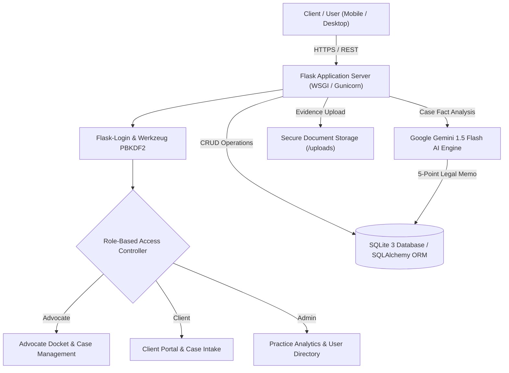
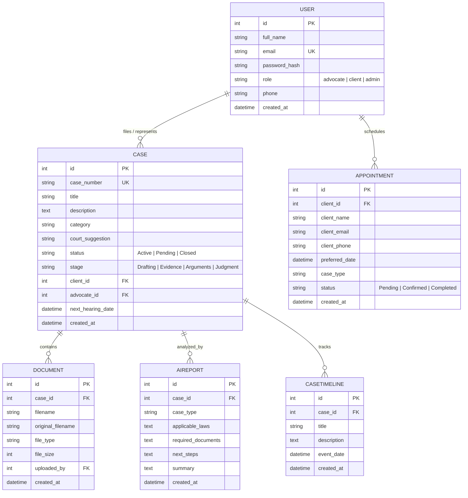

# ⚖️ Legal AI Assistant & Practice Management Portal
### *Official Digital Chambers of Advocate Mukesh Singh Rathod — Private Advocate & Legal Counsel*

[](https://github.com/yashrajr368-ops/adocate-ai)
[](https://www.python.org/)
[](https://flask.palletsprojects.com/)
[](https://ai.google.dev/)
[](https://getbootstrap.com/)
[](https://www.sqlite.org/)
[](#-bilingual-support-english--हिंदी)
[](https://github.com/yashrajr368-ops/adocate-ai)
[](LICENSE)

---

## 📌 Executive Summary

**Legal AI Assistant & Practice Management Portal** is a production-grade, enterprise-ready legal technology platform engineered for the private legal practice of **Advocate Mukesh Singh Rathod — Private Advocate & Legal Counsel** practicing before the **District & Sessions Courts (Khandwa)**, **Sub-Divisional Civil & Criminal Courts (Harsud-Chhanera)**, Revenue Courts, and Consumer Dispute Redressal Commissions in Madhya Pradesh.

The platform bridges the gap between citizens seeking preliminary legal clarity and legal chambers requiring efficient practice management. By fusing **Google Gemini Generative AI** with a robust **Role-Based Practice Management System (PMS)**, the application delivers instant, bilingual legal triage for citizens while streamlining docket schedules, document discovery, hearing timelines, and consultation bookings for legal practitioners.

---

## 👨‍💻 Author & Lead Engineer

| Metric | Details |
| :--- | :--- |
| **Lead Developer** | **Yash Raj Singh Rathod** |
| **Academic Program** | B.Tech in Computer Science & Engineering (Artificial Intelligence) |
| **University** | **Medi-Caps University**, Indore, Madhya Pradesh |
| **GitHub Profile** | [@yashrajr368-ops](https://github.com/yashrajr368-ops) |
| **Repository** | [https://github.com/yashrajr368-ops/adocate-ai](https://github.com/yashrajr368-ops/adocate-ai) |
| **Legal Practice Client** | Chambers of Advocate Mukesh Singh Rathod (Private Advocate & Legal Counsel) |

---

## 🏛️ Official Practice Identity & Jurisdictions

The platform is strictly branded for the private chambers of **Advocate Mukesh Singh Rathod**:
- **Designation**: Private Advocate & Legal Counsel *(strictly focused on District, Sub-Divisional, Revenue, and Consumer Courts)*.
- **Core Jurisdictions**:
  - District & Sessions Court, Khandwa (M.P.)
  - Sub-Divisional Civil & Criminal Courts, Harsud-Chhanera (M.P.)
  - Judicial Magistrate First Class (JMFC) Courts
  - Sub-Divisional Revenue & Tehsildar Courts
  - District Consumer Disputes Redressal Commission
- **Practice Areas**: Civil Litigation, Criminal Defense, Revenue & Agricultural Land Disputes, Family & Matrimonial Law, Negotiable Instruments Act (Cheque Bounce - Sec 138), Consumer Protection, and Bail Applications.
- **Chambers Address**: Near District Court Complex, Harsud-Chhanera, Madhya Pradesh — 450119.
- **Direct Contacts**: Telephone / WhatsApp: `+91 98269 35975` | Email: `contact@advocatemukeshrathod.in`.

---

## ✨ Key Features & Capabilities

### 🌐 1. Full Bilingual Support (English & हिंदी)
- **Instant UI Language Switcher**: A single-click toggle (`🌐 English | हिंदी`) in the top navigation bar dynamically translates navigation labels, hero sections, triage intake forms, practice areas, counsel bio, FAQs, and dashboards without requiring a page reload.
- **Bilingual AI Triage Engine**: Automatically detects whether a query is written in Hindi (Devanagari script) or English and responds in the exact corresponding language.
- **Persistent Localization**: Remembers the client's language preference across page refreshes and browser sessions using HTML5 `localStorage`.

### 🤖 2. Gemini AI Legal Analysis Desk
- **Structured 5-Point Legal Memorandum**:
  1. **Case Categorization**: Instant classification into Civil, Criminal, Revenue, Family, Consumer, or Labour law.
  2. **Applicable Laws & Statutory Sections**: Precise references to relevant Indian statutes (*Bharatiya Nyaya Sanhita 2023 / IPC, Bharatiya Nagarik Suraksha Sanhita 2023 / CrPC, Bharatiya Sakshya Adhiniyam 2023 / Indian Evidence Act, Hindu Marriage Act, NI Act Section 138, Consumer Protection Act*).
  3. **Required Evidentiary Documentation**: Clear checklist of essential documents required for filing or defense.
  4. **Next Procedural Steps**: Step-by-step guidance on notice issuance, court filing, and jurisdictional protocol.
  5. **Executive Summary & Counsel Disclaimer**: Clear legal conclusion with Bar Council of India compliant disclaimers.
- **Strict Indian Law Guardrails**: Rejects non-legal, malicious, or off-topic queries with polite, domain-specific guidance.
- **Automated Court Suggestions**: Automatically suggests the exact court of competent jurisdiction based on dispute facts.

### 🏛️ 3. Multi-Role Practice Management (RBAC)
- **Advocate Portal (`advocate@example.com`)**:
  - Live docket dashboard displaying total active caseload, pending hearings, and recent case submissions.
  - Multi-stage case progress tracker (*Drafting ➔ Notice Issued ➔ Evidence ➔ Cross-Examination ➔ Final Arguments ➔ Judgment*).
  - Hearing calendar and chronological case timeline updates.
  - Document discovery vault with direct file inspection and download.
- **Client Portal (`client@example.com`)**:
  - Real-time case tracking with next hearing dates and advocate's private notes.
  - Interactive Case Intake form with automated AI analysis upon submission.
  - Evidence document upload center (PDF, Word, Images up to 16MB).
  - 1-click consultation appointment scheduler with lead counsel.
- **Admin Portal (`admin@example.com`)**:
  - Practice-wide analytics, system-wide caseload metrics, user directory, and platform administration.

### 📑 4. Court-Ready Case Dossier & Letterhead Generation
- Generates a formal, printable / PDF case report formatted with official chambers letterhead:
  - Header: *"CHAMBERS OF ADVOCATE MUKESH SINGH RATHOD — Private Advocate & Legal Counsel"*
  - Case metadata, registration dates, court jurisdiction, and opposing party details.
  - Complete AI Legal Analysis report and procedural timeline.
  - Confidentiality Notice: *"CONFIDENTIAL ATTORNEY-CLIENT PRIVILEGED WORK PRODUCT"*.

### 📅 5. Consultation & Appointment Pipeline
- Integrated consultation scheduler with chamber hours, preferred consultation dates, matter description, and simulated email confirmation dispatch.

---

## 🏗️ Technical Architecture



---

## 🛠️ Complete Tech Stack

| Layer | Component | Specification |
| :--- | :--- | :--- |
| **Backend Framework** | Python 3.12+ / Flask 3.1 | Micro-framework handling routing, controllers, and business logic |
| **AI / LLM Engine** | Google Gemini API | `gemini-1.5-flash` model via `google-generativeai` SDK |
| **Database & ORM** | SQLite 3 / SQLAlchemy 2.0 | Relational schema mapped with `Flask-SQLAlchemy` ORM |
| **Authentication** | Flask-Login & Werkzeug | Cookie-based session authentication with PBKDF2-SHA256 password hashing |
| **Frontend UI** | HTML5, CSS3, JavaScript | Modern responsive layout built with Bootstrap 5.3 & custom styles |
| **Iconography & Fonts** | FontAwesome 6 & Google Fonts | Professional legal typography (*Cinzel* & *Inter*) |
| **Visual Analytics** | Chart.js | Dynamic caseload distribution and case status visualizations |
| **WSGI Server** | Gunicorn 21.2+ | Production WSGI HTTP server for high-concurrency cloud environments |
| **Automated Testing** | Python `unittest` | 10-point end-to-end integration test suite |

---

## 🗄️ Database Schema



---

## 🚀 Quick Start (Local Installation)

### 1. Clone the Repository
```bash
git clone https://github.com/yashrajr368-ops/adocate-ai.git
cd adocate-ai
```

### 2. Set Up a Virtual Environment
```bash
# Windows
python -m venv venv
venv\Scripts\activate

# macOS / Linux
python3 -m venv venv
source venv/bin/activate
```

### 3. Install Dependencies
```bash
pip install -r requirements.txt
```

### 4. Configure Environment Variables
Create a `.env` file in the root directory:
```env
SECRET_KEY=your_secure_random_flask_secret_key_2026
GEMINI_API_KEY=your_google_gemini_api_key_here
```
*(You can obtain a free API key at [Google AI Studio](https://aistudio.google.com/))*

### 5. Launch the Application
```bash
python app.py
```
Open your browser and navigate to: **`http://127.0.0.1:5000`**

---

## 🧪 Automated Testing Suite

The project includes an end-to-end automated test suite verifying core functional paths:

```bash
python test_app.py
```

### Test Execution Results:
```text
----------------------------------------------------------------------
Ran 10 tests in 0.782s

OK
[PASS] Home page loaded with lead counsel Advocate Mukesh Singh Rathod.
[PASS] AI Chatbot legal query returned structured response.
[PASS] AI Chatbot non-legal query was politely declined by guardrail.
[PASS] Client logged in and accessed client dashboard.
[PASS] New case submitted and automatic AI legal analysis generated successfully.
[PASS] Document uploaded, database linked, and downloaded successfully.
[PASS] Advocate dashboard accessed and case status updated successfully.
[PASS] Printable / PDF Case Report view rendered with court formatting.
[PASS] Appointment booking and simulated confirmation email completed.
[PASS] Admin dashboard loaded with system analytics and user controls.
```

---

## 🔐 Pre-Seeded Demonstration Accounts

For convenience during demonstrations and evaluation, the database auto-seeds the following test accounts:

| Role | Email Address | Password | Functionality |
| :--- | :--- | :--- | :--- |
| **Advocate** | `advocate@example.com` | `password123` | Full access to advocate docket, hearing dates, client evidence, and status updates |
| **Client** | `client@example.com` | `password123` | Client portal with active dispute, document upload center, and appointment scheduler |
| **Admin** | `admin@example.com` | `password123` | Practice administrator with analytical metrics and caseload distribution |

---

## ☁️ 1-Click Free Cloud Deployment (Render.com)

1. Push your repository to **GitHub**:
   ```bash
   git push -u origin main
   ```
2. Navigate to [Render.com](https://render.com/) and sign in with your GitHub account.
3. Click **"New +"** ➔ **"Web Service"** ➔ Select **`adocate-ai`**.
4. Configure the service settings:
   - **Environment**: `Python`
   - **Build Command**: `pip install -r requirements.txt`
   - **Start Command**: `gunicorn app:app`
5. Under **Environment Variables**, add:
   - `GEMINI_API_KEY`: *(Your Google Gemini API Key)*
   - `SECRET_KEY`: *(Random secure string)*
6. Click **"Deploy Web Service"**. Within 2 minutes, your live cloud application will be accessible 24/7 worldwide at:
   `https://adocate-ai.onrender.com`

---

## 📄 Resume Project Section (Ready to Copy)

```markdown
AI Advocate & Legal Practice Management Portal | Python, Flask, Google Gemini AI, SQLite
GitHub: https://github.com/yashrajr368-ops/adocate-ai | Live Demo: https://adocate-ai.onrender.com
• Architected a production-grade legal assistance platform for Advocate Mukesh Singh Rathod featuring full 
  bilingual support (English & Hindi) and role-based access control (Advocate, Client, Admin).
• Integrated Google Gemini AI to automate preliminary legal triage, generating structured 5-point legal memorandums 
  (applicable statutory sections under BNS/IPC/BNSS, required evidentiary documents, court jurisdiction, and next steps).
• Implemented an active case docket with stage tracking, evidence file discovery vault, appointment booking, and court dossiers.
• Engineered a 10-point automated integration test suite validating authentication, RBAC, document handling, and AI guardrails.
• Tech Stack: Python 3.12, Flask 3.1, Google Gemini API, SQLite, SQLAlchemy, Bootstrap 5.3, Gunicorn.
```

---

## ⚖️ Legal Compliance & Ethics

This platform is an AI-augmented decision support and practice management system built under the regulatory guidelines of the **Advocates Act, 1961** and the **Bar Council of India Rules**. 
- The AI analysis is intended solely for preliminary research, legal literacy, and practice assistance.
- It does not constitute formal legal advice or create an advocate-client relationship without a signed vakalatnama or formal engagement with Advocate Mukesh Singh Rathod.

---

## 📜 License

Distributed under the **MIT License**. See `LICENSE` for complete details.
